# Ascendancy-4.0
The fourth iteration of my homelab, Ascendancy.

## Overview
Notable changes:
- Configuration of a reverse proxy, forcing HTTPS connections and allowing the use of a custom domain.
- Checkmk, an enterprise tool for advanced monitoring.
- Eden-MC, a public Minecraft Java server behind a proxy with a plugin providing Bedrock support.
- Upgrade of main the Proxmox node for increased performance and decreased power draw.
- New Unifi switch for seamless VLAN management.

## Hosts
### Avidich
*Refuge from Csilla*

- **Type:** Virtual machine

**Nginx Proxy Manager (Podman)** \
    Avidich is the host of my proxy, which allows me to access homelab services over HTTPS, using my custom domain, `csil.la`, named after the planet Csilla.

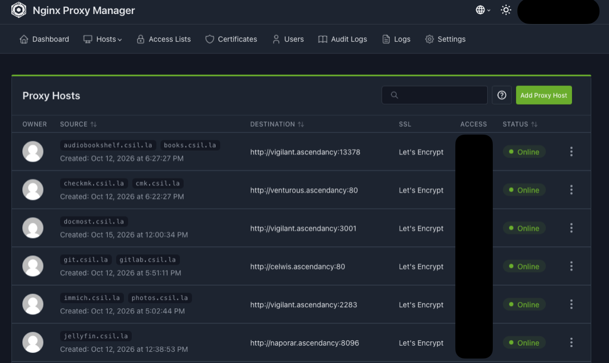

### Celwis
*Stronghold of the Xodlak family*

- **Type:** Virtual machine

**GitLab (Linux Package)** \
    Storage for all crontabs, backup scripts, and config files, GitLab is my main repository and version control software for my homelab.

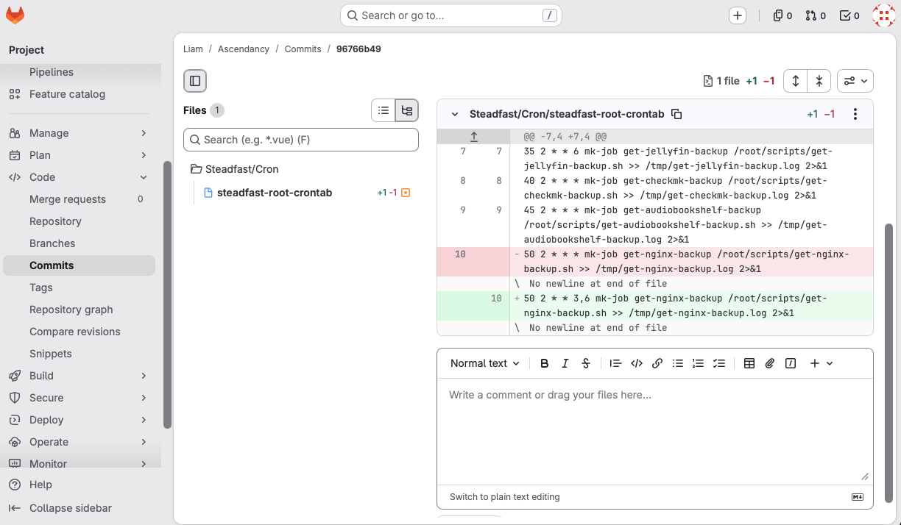

### Ghorman
*Rich in silk, and in kalkite*

Not technically a host, but worth a mention. I no longer use the NUT server on this device, or at all, it has been incredibly finicky.

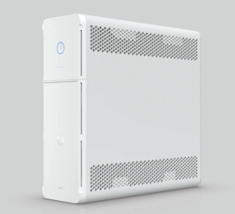

### Grayshrike
*Chiss heavy cruiser*

- **Type:** LXC

**WireGuard + WGDashboard** \
    Remote access, fairly straightforward. I may adopt Netbird/Tailscale/Twingate at some point, since rebooting my router assigns me a new IPv4 address, requiring all clients to update their config.

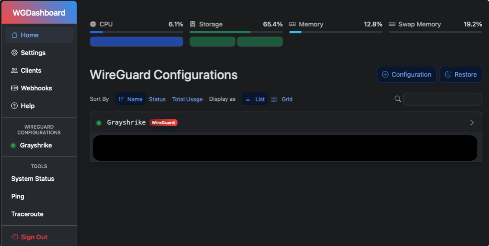

### Naporar
*Headquarters of the Chiss Expansionary Defense Fleet*

- **Type:** Virtual machine

**Minecraft Java (Podman)** \
    A vanilla Java server for use by myself and friends.

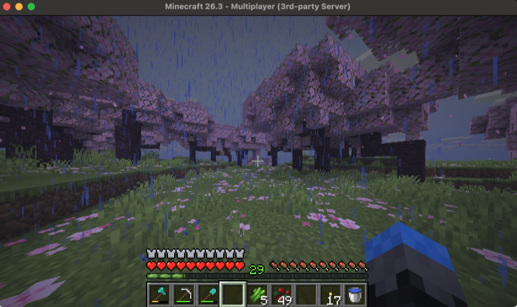

**Jellyfin (Podman)** \
    Liberating my DVDs, I can stream them from any device.

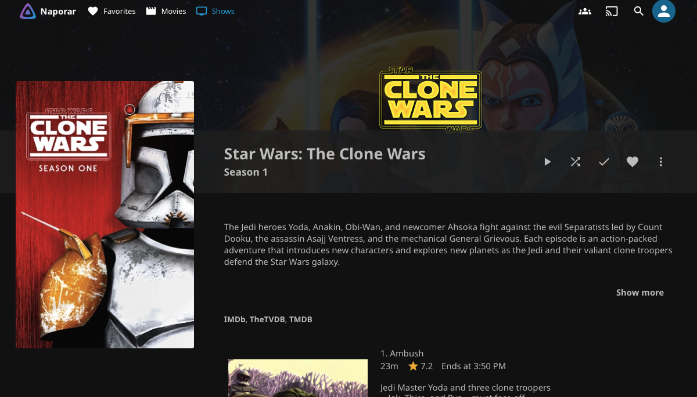

### Orisson
*Light cruiser of the Clarr family*

- **Type:** Virtual machine

**Velocity (Podman)** \
    Hosted on Akamai's cloud infrastructure, this VM serves as the Proxy for the Eden-MC Minecraft server. Velocity is the proxy, and Geyser is a plugin that translates UDP Minecraft packets (from Bedrock) to TCP Minecraft packets (for Java). Floodgate allows players with translated packets to connect to a Java server without a paid Java account. With these plugins, cross-play between Java and Bedrock is made possible on Eden-MC.

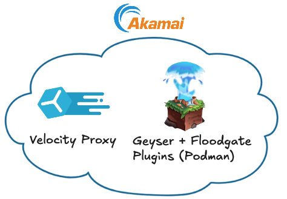

### Peregrine
*Heavy cruiser of General Garm Bel Iblis*

- **Type:** Physical host, ThinkCentre M720Q

Proxmox is installed on this device, but nothing is running on it yet. I purchased this ThinkCentre to work on larger projects like Active Directory while keeping it segmented from my main Proxmox host. Since it's not in use, it's also sort of a backup for Springhawk, if I needed to move any VMs to it.

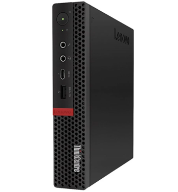

### Rhigar
*Stronghold of the Clarr family*

- **Type:** Virtual machine

**Minecraft + Website for Eden-MC (Podman)** \
    Accepting data from the proxy on Orisson through a WireGuard tunnel, Rhigar hosts the Minecraft server Eden. It also serves a simple Nginx website through a Cloudflare tunnel, to not expose my public IP.

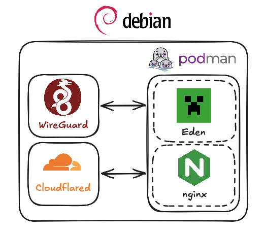

### Springhawk
*Heavy cruiser of Mitth'raw'nuruodo*

- **Type:** Physical host, GMKtec M3 NucBox

**Proxmox** \
    Upgraded from the HP Z2 Mini G4, the new Springhawk has performed wonderfully, with a few tweaks. Constant turboing of the CPU caused fast and dramatic jumps in both fan speed and internal temperature. The fan changes were making me go crazy, and high temperatures are not good for such a small device long term. \
    To decrease the base temperature, I swapped the power mode in the BIOS to the 25W option. I also changed the CPU governor to `powersave`, causing the base temperature to decrease ~20°C, with no noticeable drop in performance. Despite these changes, the fan can still go crazy when the CPU ramps up, so I set a static fan speed in the BIOS of about 50%. 

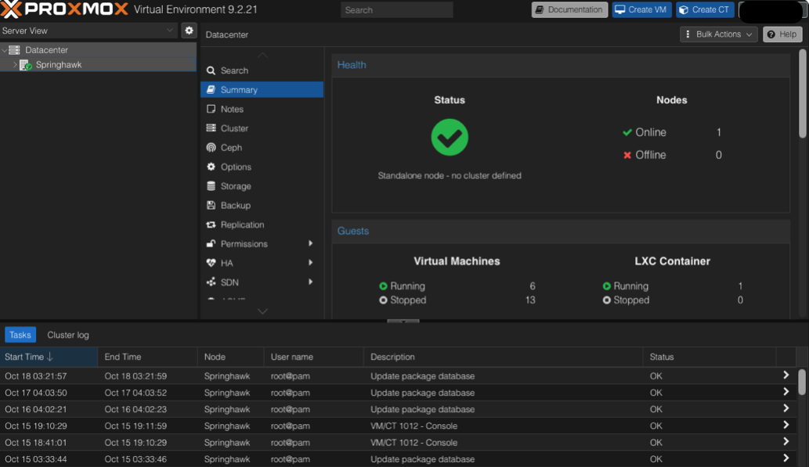

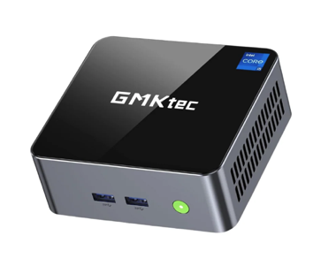

### Steadfast
*Chiss heavy cruiser*

- **Type:** Physical host, Raspberry Pi 5 8GB

**NAS** \
    Mass file storage for various things, as well as the main backup location for all hosts/services. Backups in my environment are two parts, one to create the backup, and the second to fetch the backup. The strategy to creating a backup depends on what is being backed up, and if the service has a built-in backup feature. \
    Alternatively, fetching the backup is simple, and the same across the environment. Using cron, a script is run for each service, where Steadfast uses `scp` to copy a tarball to the correct directory, using a SSH key created specifically for communication between Steadfast and that host.

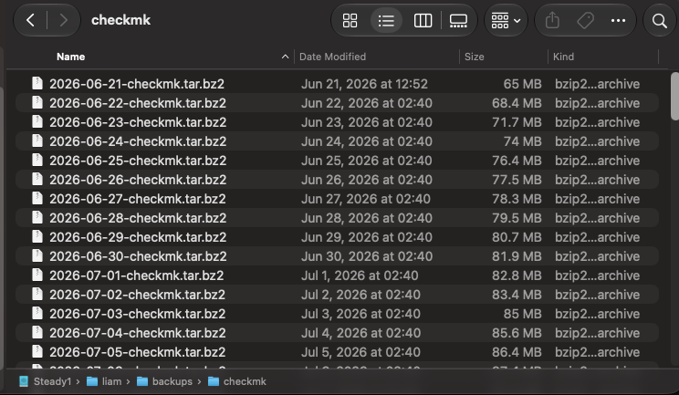

**Pihole (Linux Package)** \
    Arguably the heart of the homelab, my Unifi gateway tells clients that Pihole hosted on Steadfast is the sole DNS server. With this, Pihole blocks lots of ads and trackers, in addition to storing local queries such as all entries for the reverse proxy domains. It's worth noting that most queries are local and not blocked, due to my use of Checkmk.

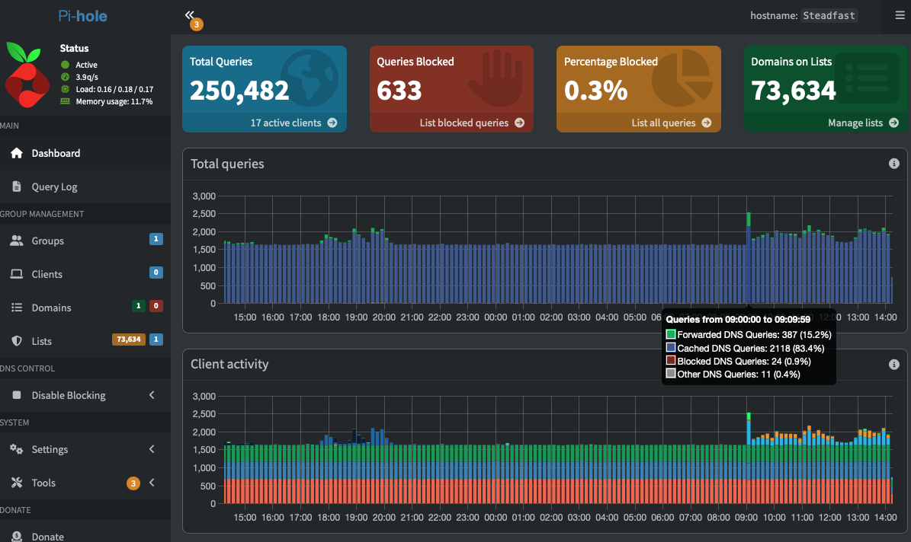

**Navidrome (Podman)** \
    Music streaming for albums I already own. On desktop, I use Sonora (pictured below), and on iOS I use Amperfy.

### Venturous
*Chiss Groundlion man-of-war*

- **Type:** Virtual machine

**Checkmk (Linux Package)** \
    Checkmk is used not just to see whether a specific host is up or down, but to keep track of its temperature, disk usage, cron job exit codes, its containers, and a lot more. After setting it up, I finally understand the term "alert fatigue." If you're considering using Checkmk for your homelab, spend some time learning the notification system, including fallback notifications.

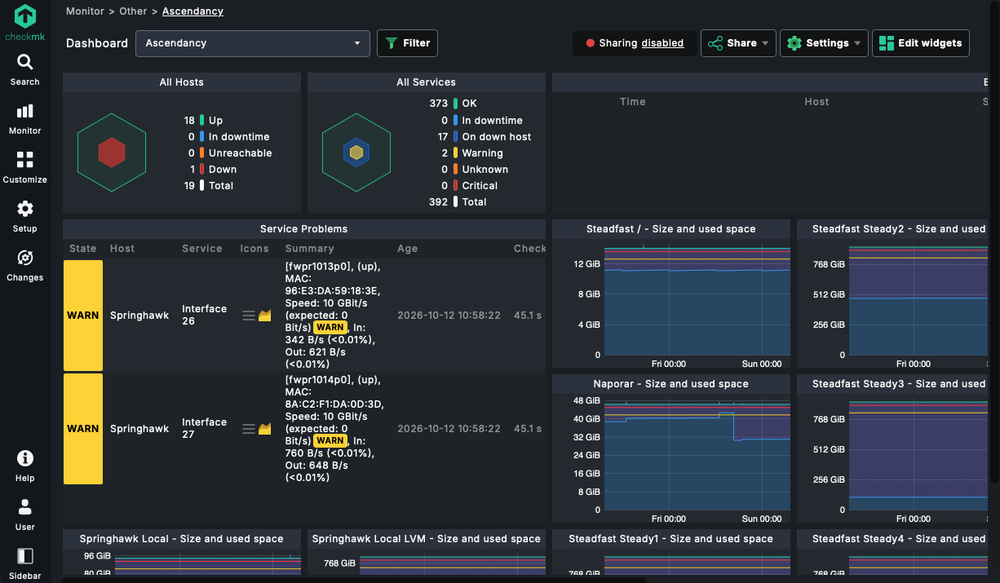

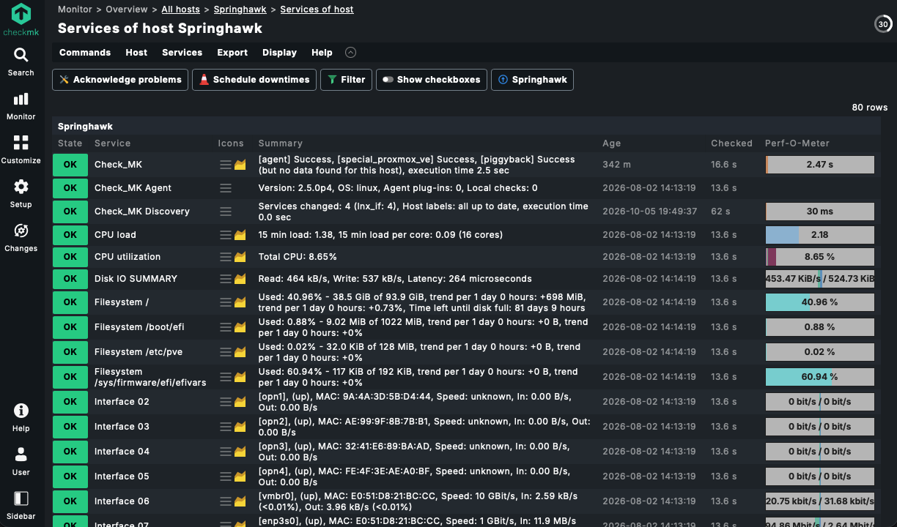

### Vigilant
*Admiral Ar'alani's flagship, a Nightdragon man-of-war.*

- **Type:** Physical host, Raspberry Pi 5 8GB

**Audiobookshelf (Podman)** \
    Liberating my collection from Apple Books, I can now listen to my treasured Star Wars audiobooks on any device!

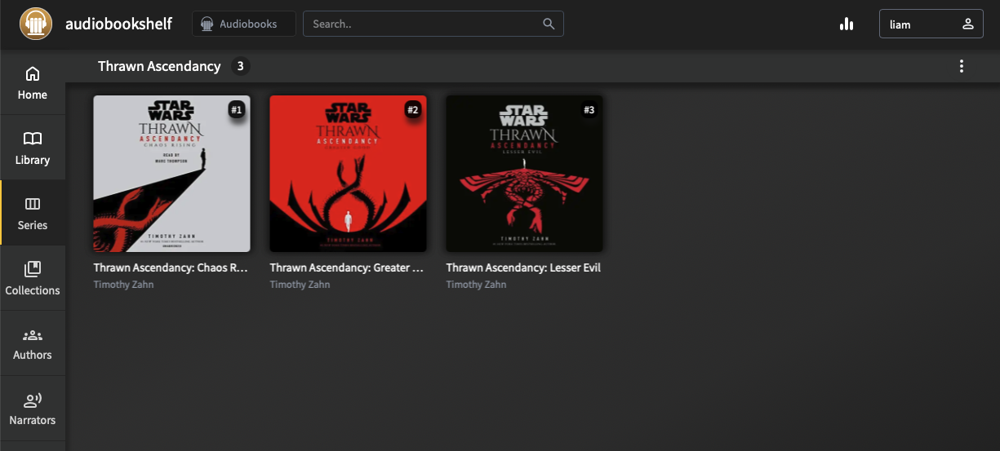

**Docmost (Podman)** \
    GitLab stores the actual configs for all my services, but setup instructions, numerous notes, and my to-do list are stored in Docmost. It's a Notion-like service in that it is a markdown editor that looks similar. Cross-page databases are not supported without an enterprise plan :/.

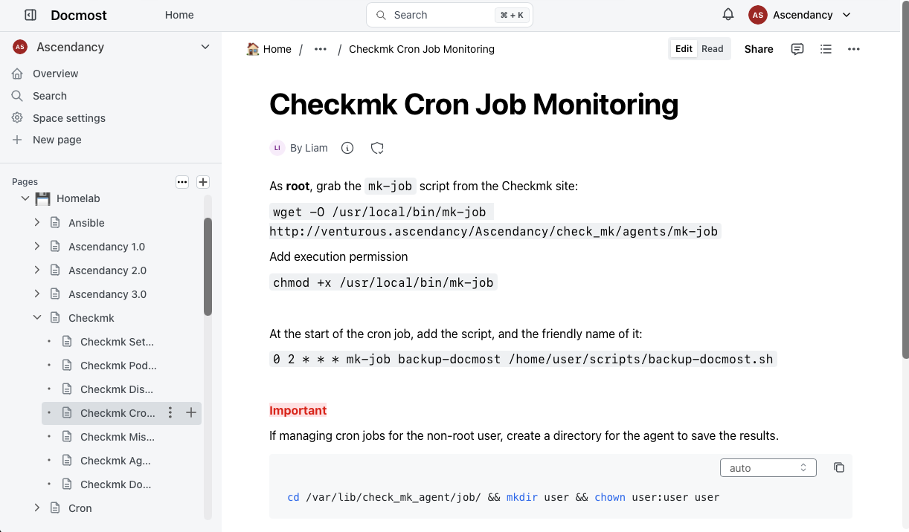

**Immich (Podman)** \
    Maybe my favorite self-hosted app because of its usefulness of backing up images, and the peace of mind it gives me.

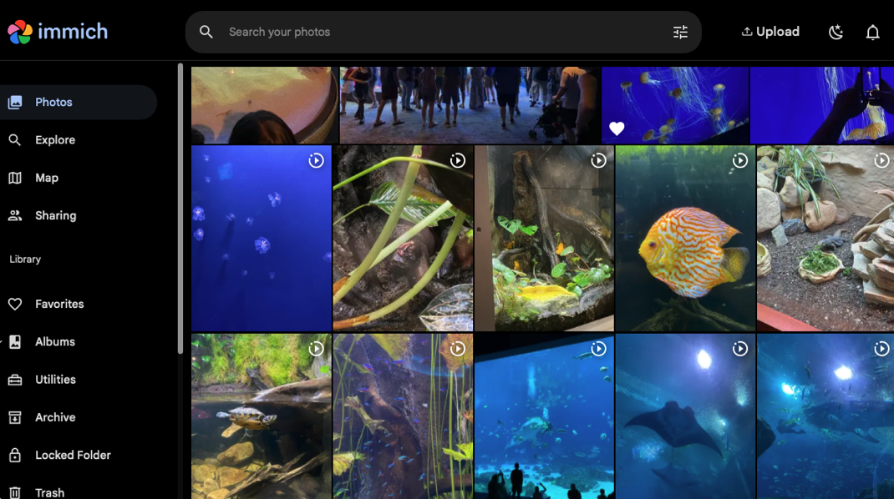

**Paperless (Podman)** \
    Repository for scanned documents, PDFs and otherwise. #not-an-ad

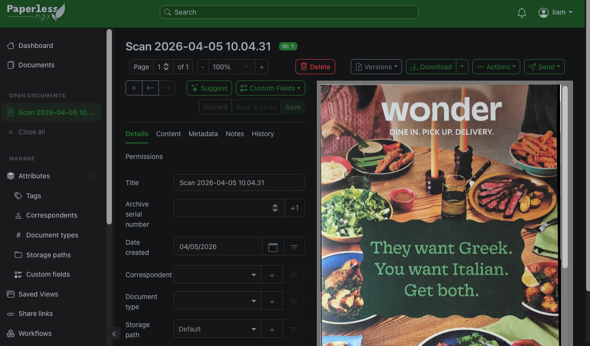